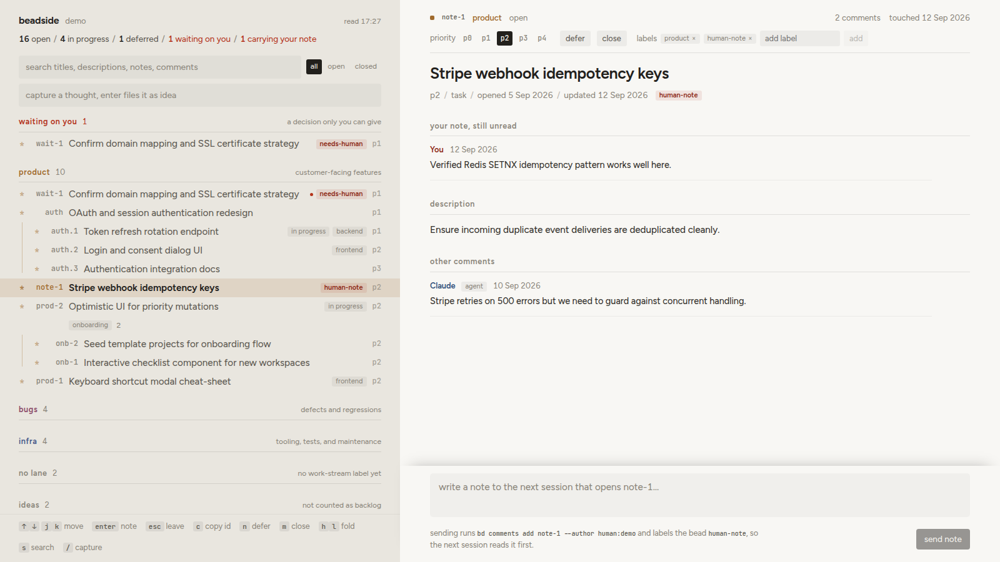

# beadside

Local web reader for a [beads](https://github.com/gastownhall/beads) backlog. It opens on an inbox of what you can clear in one action. Index on the left with sections and lanes, and the selected bead always open on the right with its Markdown-rendered description, notes, comments, sessions, and linked notes. Sending a note from the composer appends a comment under your own author id and can flag the bead so your coding agent reads it first on its next run. Search covers ids, titles, descriptions, notes and comments, on the board and from a terminal.



Formerly bd-board. The old names still work: `bd-board` runs the same CLI (it prints a one-line notice on stderr), a `.bd-board.json` loads when no `.beadside.json` exists, and `beadside stop` and `status` still find a board started under the old name. `systemd/install.sh` retires an old `bd-board.service`.

## requirements

- Node 22+
- `bd` on PATH
- a beads repository

## run

```bash
git clone https://github.com/thatmike1/beadside
cd beadside
npm install
npm run build
```

Run in any beads repo:

```bash
beadside                 # in a beads repo; or: beadside --repo /path/to/repo
```

Or keep it off your terminal:

```bash
beadside start           # runs in the background, takes the same flags
beadside status          # url of the board for this repo
beadside stop            # ends it, from the same repo
```

Install the launcher once to run it from anywhere:

```bash
ln -s "$PWD/bin/beadside.mjs" ~/.local/bin/beadside
```

### search from a terminal or an agent

```bash
beadside search "cooler swap"                 # all beads, closed and parked included
beadside search webhook --scope open --json   # structured hits for an agent
```

Same ranking as the board's search box; see `docs/api.md` for the result shape.

### flags

| flag | default | description |
|---|---|---|
| `--repo <path>` | current directory | path to the beads repository |
| `--port <n>` | first free from `1338` | local port to bind; without it a second board next to a running one takes the next free port |
| `--config <path>` | `<repo>/.beadside.json` | explicit path to config file |
| `--agentsview <url>` | from config or off | AgentsView server url |
| `--no-agentsview` | | force disable AgentsView join |
| `--no-open` | `false` | do not open default browser on start |

## inbox, board and stale

The board opens on the **inbox**, which holds only what one action clears:

- **replies**: beads where an agent commented after your latest note and you have not opened the bead since. A reply you open holds its place while it is open, then drops to the bottom of replies, dimmed and marked read, and leaves on the next reload or view switch, so skimming several in a row does not eat the list. The seen markers live in bd's key-value store (`bd kv`), not in the browser, so two boards over clones of the same beads database (a desktop and a server you read from the phone) share them once `bd sync` has run on both. See `docs/api.md` for the key scheme
- **answered, closed**: a closed bead lands here only when you commented on it and an agent replied or the bead closed after your comment, so an answer that came with the close is not lost. The row says who replied, that it closed and the close reason; it clears like a reply, by opening it, and a closed bead whose answer is older than 14 days stays out. A bead you close from beadside counts as read
- beads carrying an **inbox label** (`inbox.labels`, by default the labels a note offers to clear)
- **due**: overdue or due within 7 days (`due_at`), each with one-click re-dates (`+1w`, `+2w`, a date)
- **stale**: three stale beads a day wanting a verdict. The day's three are drawn in an order seeded by the date and held for that day in `bd kv`, so a bead you settle is not replaced until tomorrow and every synced board shows the same three

An emptied inbox says so. `b` switches to the **board**, the lanes as before, and `o` to **stale**: every open bead untouched for 30+ days (`updated_at`), oldest first. Parked, pinned and thought beads never go stale. Each stale row offers:

- **keep**: stamps `kept_at=<day>` into the bead's metadata, which moves `updated_at` so it leaves the filter for 30 days
- **snooze 4w**: `bd defer --until +4w`
- **close**: closes it with the reason "stale, closed from beadside"

The detail pane lists the bead's links grouped by kind and direction, headed as `bd show` heads them (parent, children, depends on, blocks, related, discovered from, discovered, superseded by, supersedes); bd's `related` and `relates-to` share one group. A click opens the linked bead.

## works with no config

Out of the box with no configuration file, beadside displays a complete board over any beads backlog:
- single open section containing all active beads, grouped hierarchically by epic and by project labels shared across 2+ beads
- pinned beads (bd's `pinned` status, open indefinitely) in a strip at the top
- deferred beads parked in their own section
- recently closed section showing the last twelve resolved items
- right pane detail view with descriptions, issue notes, and comment threads
- an inbox with agent replies, due dates and stale beads, and a stale filter
- quick capture (`/`) to file new beads directly into your backlog
- full keyboard navigation

## designing labels for the board

To structure your backlog into custom lanes and workflow states, add an optional `.beadside.json` file to the root of your beads repository.

### lanes

Pick 3 to 6 labels that answer "what kind of work is this", and give every open bead exactly one lane label. Beads without a lane label appear in an unlaned section.

Example vocabularies:
- by area: `product`, `bugs`, `infra`, `ideas`
- by horizon: `now`, `next`, `later`

### waiting flag

A flag label such as `needs-human`. Your coding agent adds this label when the next step requires human input or an architectural decision. The board pins these beads to a dedicated section at the very top.

### note flag

A flag label such as `human-note`. When you submit a note from the board's composer box, beadside adds this label. Your agent inspects this label first, addresses your note, and clears the flag.

### inbox labels

`inbox.labels` names the labels that put a bead in the inbox. Leave the block out and the inbox takes `note.offerToClear`, the labels one note settles. Keep slower labels, such as one asking for a conversation first, out of it: they stay in the waiting section.

### thoughts drawer

A label such as `idea` for raw captures that should not clutter your active backlog. Beads carrying this label stay in a dedicated thoughts drawer and are excluded from lane counts. Set `capture.labels` to `["idea"]` and quick capture files every new bead there.

### project labels

Any other label that is not a lane label, sub-label, or workflow flag automatically groups beads within a lane whenever 2 or more beads share it.

### example configuration

### comment authors

`human` sets the author id the board writes your comments as, and the name shown for it. Give agents their own ids through `BEADS_ACTOR`, which bd stores as the comment author: `agent:claude`, `agent:codex`, `agent:gemini`, or plain `agent`. Set it wherever each harness takes environment variables (Claude Code: `env` in `settings.json`; Codex: `[shell_environment_policy] set` in `config.toml`). Comments whose author is neither the human id nor an agent id show as author unknown, which is where comments written before this lands under a shared git username end up.

Here is an example `.beadside.json`:

```json
{
  "human": { "id": "human:alice", "name": "Alice" },
  "lanes": [
    { "label": "product", "note": "customer-facing features", "glyph": "*", "color": "#a06a2c" },
    { "label": "bugs", "note": "defects and regressions", "glyph": "!", "color": "#8b4a68" },
    { "label": "infra", "note": "tooling, tests, and maintenance", "glyph": "#", "color": "#47598a" }
  ],
  "unlaned": { "title": "no lane", "note": "no work-stream label yet" },
  "subLabels": ["frontend", "backend"],
  "waiting": {
    "labels": ["needs-human"],
    "title": "waiting on you",
    "note": "a decision only you can give"
  },
  "note": {
    "addLabel": "human-note",
    "offerToClear": ["needs-human"]
  },
  "inbox": { "labels": ["needs-human"] },
  "thoughts": {
    "label": "idea",
    "title": "ideas",
    "note": "not counted as backlog"
  },
  "flags": ["blocked-external"],
  "capture": {
    "labels": ["idea"]
  }
}
```

## teaching your agent the labels

Add this block to your agent instructions (`AGENTS.md` or `CLAUDE.md`):

```markdown
### Beads Workflow and Labels

Every open bead carries exactly one lane label: `product`, `bugs`, or `infra`.

Flags:
- `needs-human`: add when the next step requires human decision or verification. Remove once decided.
- `human-note`: an unread note from the human written via beadside. Read the human's latest comment (author `human:alice`) first, act on it or reply, and remove the label.

To find a bead from words you remember, run `beadside search <words>` (add `--json` for structured hits); it searches titles, descriptions, notes and comments of every bead, closed ones included.
- `idea`: raw captured thought, not active backlog. Do not work on unless asked.
```

### labelling an existing backlog

If your beads carry no labels yet, write the config and the agent block above first, then ask your agent once: "read `.beadside.json`, give every open bead exactly one lane label with `bd update <id> --add-label=<lane>`, and add `needs-human` where the next step is my decision. List what you changed." Review the board afterwards and move anything that landed in the wrong lane.

## optional joins

- **AgentsView**: if running [AgentsView](https://github.com/kenn-io/agentsview), beadside searches local session transcripts and displays recent coding sessions that touched the selected bead. Configured via `"agentsview": "http://127.0.0.1:8080"` or `--agentsview`.
- **Notes directory**: set `"notesDir": "docs/notes"` to recursively scan a folder of markdown notes and link occurrences of the bead ID.
- **T3 Code**: thread titles from `~/.t3/userdata/state.sqlite` are discovered automatically when present.

## live updates

With beads 1.3.0 or newer, turn on the events journal in the beads repo and restart the board:

```bash
bd config set events-journal true
```

The board then follows the journal and refreshes open tabs within a few seconds of any `bd` write, from an agent or a terminal. Changes pulled in by `bd dolt pull` or `bd sync` never reach the journal, so they show up within 2 minutes instead. Without the journal the board polls every 20 seconds, and its log says why.

## run as a service

Install beadside as a systemd user service:

```bash
systemd/install.sh /path/to/your/beads-repo [port]
```

This builds the UI, generates `~/.config/systemd/user/beadside.service`, reloads systemd, and starts the service.

### one service per tracker

Each tracker needs its own unit name and an explicit free port. The installer above
manages only `beadside.service`; running it again replaces that board. For additional
trackers, copy `systemd/beadside.service` to a differently named unit, change both
repository paths and the port, and adjust the launcher and PATH for your machine.
The checked-in desktop units use `nvm-exec` with `NODE_VERSION=default` so Node
upgrades do not break them.

The supplied desktop units keep ccChat-general on `beadside.service` at port 1338
and NexiFlow on `beadside-nexiflow.service` at port 1358. After building, link the
second unit without replacing the first:

```bash
ln -s "$PWD/systemd/beadside-nexiflow.service" ~/.config/systemd/user/beadside-nexiflow.service
systemctl --user daemon-reload
systemctl --user enable --now beadside-nexiflow.service
```

For a tracker shared with other machines, the board's polling refreshes the local
database but does not pull remote changes. `beads-sync-nexiflow.timer` runs
`bd sync --no-adopt` 45 seconds after login and every five minutes. It uses the
existing Dolt remote, halts on conflicts, and syncs `refs/dolt/data` without
committing or pushing the repository's code branch. Its service pins an SSH key
because the user manager has no SSH agent; adjust the key path and repository
before installing it on another machine.
Both NexiFlow services set `BD_EXPORT_AUTO=false` for their child commands, so
they leave the optional tracked JSONL export alone without changing repo config.

```bash
ln -s "$PWD/systemd/beads-sync-nexiflow.service" ~/.config/systemd/user/beads-sync-nexiflow.service
ln -s "$PWD/systemd/beads-sync-nexiflow.timer" ~/.config/systemd/user/beads-sync-nexiflow.timer
systemctl --user daemon-reload
systemctl --user enable --now beads-sync-nexiflow.timer
systemctl --user start beads-sync-nexiflow.service
journalctl --user -u beads-sync-nexiflow.service -n 20 --no-pager
```

Repeat with a unique board unit, sync service/timer pair, and port for each tracker.
Stop one board with `systemctl --user disable --now beadside-nexiflow.service`;
stop its automatic sync separately with `systemctl --user disable --now beads-sync-nexiflow.timer`.

## on a phone

Below 760px wide the board shows one pane at a time: the list, and a tapped bead sliding over it. The back gesture returns to the list with its scroll position kept. The server only listens on `127.0.0.1`, so reach it from a phone through something that proxies to it, for example Tailscale:

```bash
sudo tailscale serve --bg --https=1338 http://127.0.0.1:1338   # tailnet only
sudo tailscale serve --https=1338 off                         # undo
```

Anyone who can open the page can write to the ledger, so keep the proxy private.

## develop

```bash
npm run dev              # server on 1338 with tsx watch, vite ui on its own port proxying /api
npm run mock             # mock api from scripts/demo for ui work without bd
npm test                 # vitest test suite
npm run typecheck        # tsc type checks across server and ui
```

## layout

- `server/`: Node + Hono backend. `bd.ts` is the only place `bd` is executed; input arguments and IDs are validated before dispatch. `search.ts` is the search shared by the route and the cli, `authors.ts` reads comment authors.
- `ui/`: Vite + React frontend. `model.ts` derives render sections, groupings, counts and links from the resolved board config and issue list; `inbox.ts` derives the inbox and the stale filter.
- `docs/api.md`: HTTP contract between frontend and backend.

## keyboard

- `i` / `b` / `o`: inbox, board, stale
- `j` / `k` or `Down` / `Up`: move selection
- `Enter`: focus note composer
- `Esc`: leave note composer / blur
- `c`: copy short issue ID
- `n`: defer selected bead
- `m`: close selected bead
- `h` / `l`: fold / unfold section (board)
- `s`: focus search; in the box `Up` / `Down` step through hits, `Enter` opens the hit and returns the keys to the list, `Esc` clears and puts the board back where it was
- `/`: focus quick capture
- `t`: switch between light and dark; the board starts in whichever your system prefers and remembers the switch
- `?`: show or hide this list; the `?` button at the top of the index opens it too
